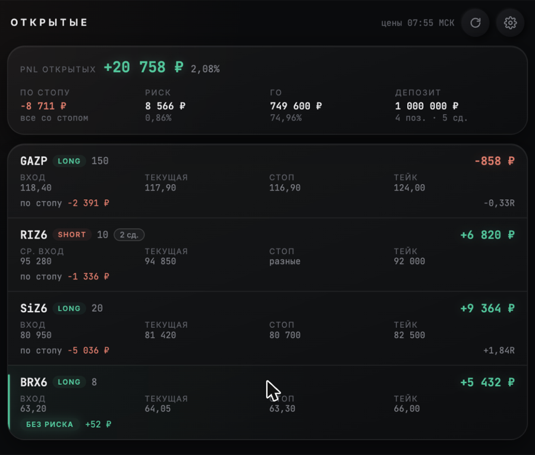
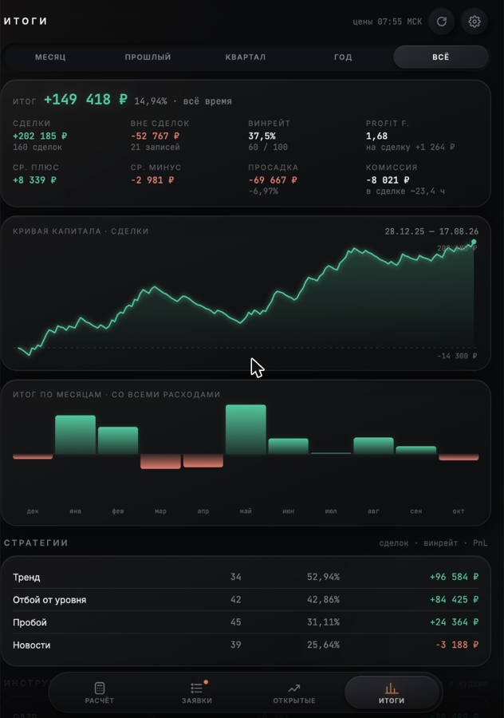
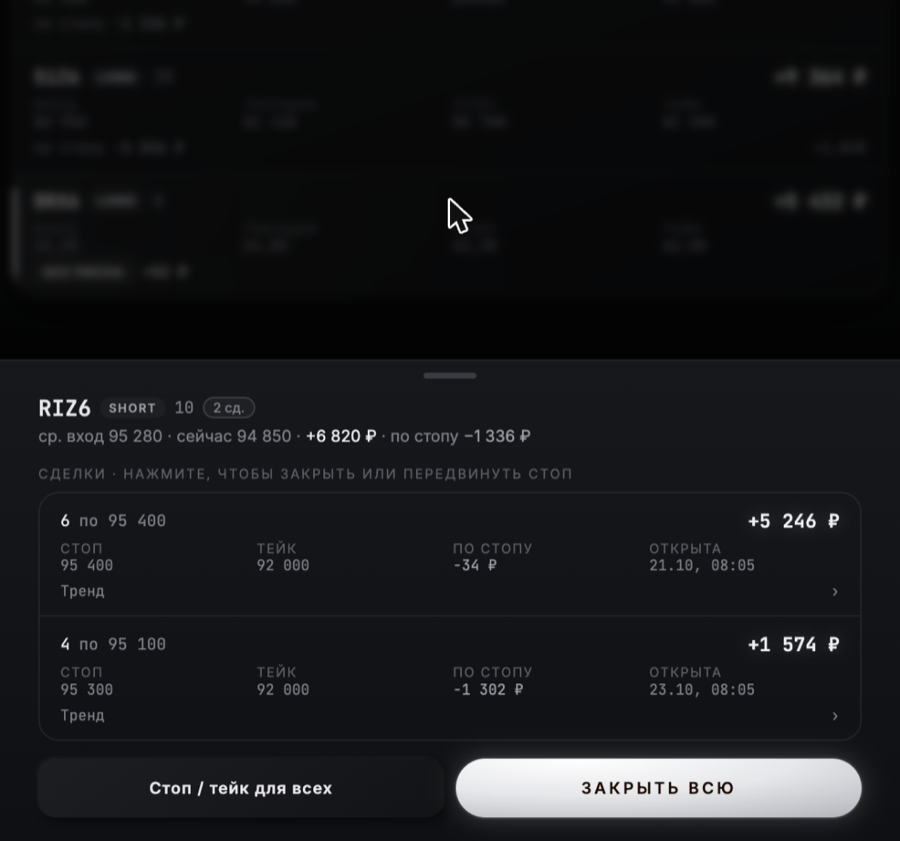
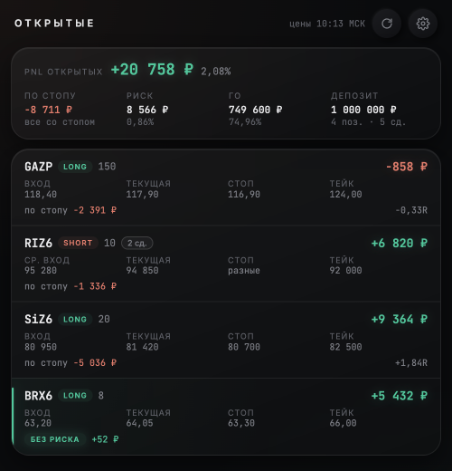
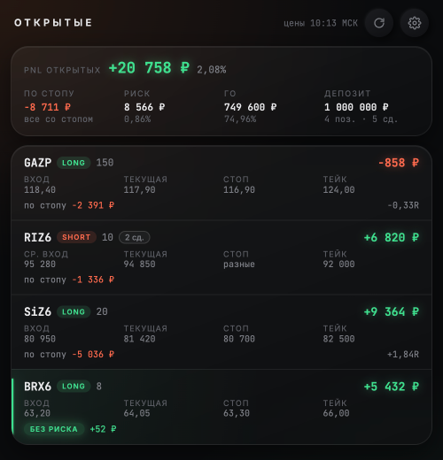
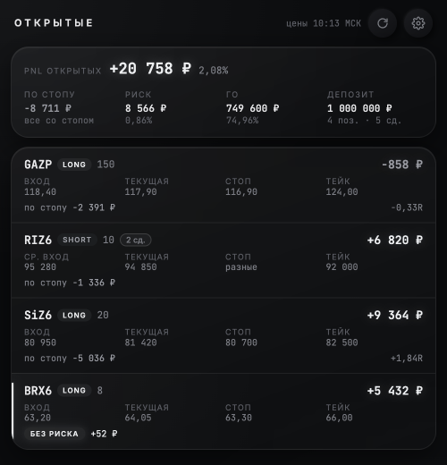

# Торговый журнал

Журнал сделок и калькулятор позиции для Московской биржи (фьючерсы FORTS и акции TQBR). Работает на iPhone и Mac как приложение, данные хранятся в **вашей собственной** Google Таблице.

**Приложение:** https://kapsops.github.io/trade-journal/

  
  
  

На скриншотах — выдуманные данные.

### Три темы — переключаются в ⚙

| Приглушённая | Неон | Монохром |
|:---:|:---:|:---:|
|  |  |  |
| мягкий изумруд и персик — по умолчанию | яркий неон | белая подсветка без цвета, глаза не устают |

## Что умеет

- **Расчёт** — объём позиции под заданный риск (₽ или % депозита), R:R, ГО, комиссия, цена удержания через ночь. Котировки MOEX подтягиваются сами. Для акций — сравнение с фьючерсом на ту же бумагу: комиссия и перенос дешевле или дороже.
- **Заявки** — из калькулятора одной кнопкой; «Исполнена» переносит в открытые.
- **Открытые** — PnL, риск, ГО, «сколько будет, если сработает стоп», отметка **«без риска»**, когда стоп в безубытке. Сделки по одному инструменту объединяются в позицию со средним входом, как у брокера; закрыть можно всю позицию, часть или конкретную сделку.
- **Итоги** — итог с расходами вне сделок (РЕПО, плата за плечо, пени, дивиденды), винрейт, profit factor, просадка, кривая капитала, результат по месяцам, стратегиям и инструментам, история сделок с поиском.
- **Импорт отчёта брокера** (.xls «Финама») — сделки, комиссии, РЕПО и прочее подтягиваются сами, повторы пропускаются.
- Действия видны на экране сразу, запись в журнал идёт в фоне.

## Как это устроено

- **Приложение** (этот репозиторий, GitHub Pages) — только интерфейс. Ваших данных здесь нет.
- **Журнал** — Google Таблица со скриптом в вашем Google-аккаунте: хранит сделки, считает, импортирует отчёты.
- Приложение обращается к журналу по адресу и **ключу доступа**, которые хранятся только на ваших устройствах. Без ключа журнал никому ничего не отдаёт.

## Установка (≈10 минут)

Скрипт журнала уже встроен в шаблон: при копировании таблицы он копируется вместе с ней. Писать или вставлять код не нужно — только нажать несколько кнопок.

### 1. Свой журнал

1. Откройте шаблон и создайте копию: **[Создать копию журнала](https://docs.google.com/spreadsheets/d/1ECDDCEork-zDZIH8F7Cei-ko7ud2Ke4t4mn71FxLaSE/copy)**. Копия появится в вашем Google Диске вместе со скриптом.
2. Откройте копию и подождите несколько секунд — сверху появится меню **«Журнал»**.
3. **Журнал → Сервис → Установить / починить оформление.**
   Google попросит разрешения: «Продолжить» → выберите свой аккаунт → «Google не проверил это приложение» → **«Дополнительные настройки» → «Перейти на страницу…»** → «Разрешить».
   Это нормально: скрипт ваш, он работает только с вашей таблицей. После разрешения ещё раз выберите тот же пункт меню — журнал настроится примерно за минуту (загрузит справочник MOEX, создаст ключ доступа).
4. На листе **«Настройки»** укажите депозит, лимиты риска и комиссии своего брокера.

### 2. Подключение приложения

Приложение можно взять **готовое** или сделать **свою копию** — выберите один вариант.

**Вариант А — готовое приложение (проще).** Открывайте https://kapsops.github.io/trade-journal/. Это только оформление и кнопки: ваши данные идут с вашего устройства прямо в вашу таблицу, автор приложения их не видит. Обновления приходят сами.

**Вариант Б — своя копия приложения (полная независимость).** Нужен аккаунт GitHub.
1. Нажмите **Fork** вверху этой страницы → «Create fork».
2. В своей копии: **Settings → Pages** → Source: «Deploy from a branch», Branch: **main**, папка **/ (root)** → Save.
3. Через 1–2 минуты приложение будет по адресу `https://ВАШ-ЛОГИН.github.io/trade-journal/`. Его можно менять под себя; обновления отсюда — кнопкой «Sync fork».

Дальше — одинаково для обоих вариантов:

1. В таблице: **Расширения → Apps Script**.
2. **Начать развертывание → Новое развертывание** → значок ⚙ рядом с «Выберите тип» → **Веб-приложение**.
   - Запуск от имени: **Я**
   - У кого есть доступ: **Все**
   → «Начать развертывание» (если попросит — снова разрешите доступ).
3. Вернитесь в таблицу: **Журнал → Калькулятор: ссылка и ключ** — там адрес веб-приложения и ключ.
4. Откройте приложение (вариант А или Б), вставьте адрес и ключ → «Подключить».

> «У кого есть доступ: Все» не значит, что журнал открыт всем: без вашего ключа он отвечает только «Неверный ключ доступа».

### 3. Установка на устройство

- **iPhone:** Safari → «Поделиться» → **«На экран „Домой“»**.
- **Mac:** Safari → **Файл → Добавить в Dock**.

У приложения с экрана «Домой» / из Dock своя память — при первом запуске ещё раз вставьте адрес и ключ (⚙).

## Важно

- Это не инвестиционная рекомендация. Расчёты комиссий, РЕПО и ГО приблизительные — сверяйтесь с брокером.
- Котировки MOEX бесплатные, с задержкой около 15 минут.
- Импорт отчётов пока только для брокера «Финам». Комиссии по умолчанию — тариф «Единый дневной», поменяйте на свои в ⚙ или на листе «Настройки».
- Google Apps Script отвечает 3–10 секунд — поэтому приложение сначала меняет экран, а запись идёт в фоне.
- Если ключ стал кому-то известен — смените его на листе «Настройки» и заново подключите приложение.

## Для разработчиков

- `index.html` — приложение (вкладки, лист действий, итоги), `calc.html` — калькулятор, `sw.js` + `manifest.webmanifest` — установка и работа без сети.
- `journal.gs` — весь скрипт журнала одним файлом (тот же, что в шаблоне).
- API журнала: `GET ?key=…&action=snapshot`; `POST {key, action, token, …}`, где action — `order | fill | cancel | close | edit | refresh | settings | expense | importPreview | import`.

Лицензия — [MIT](LICENSE).
